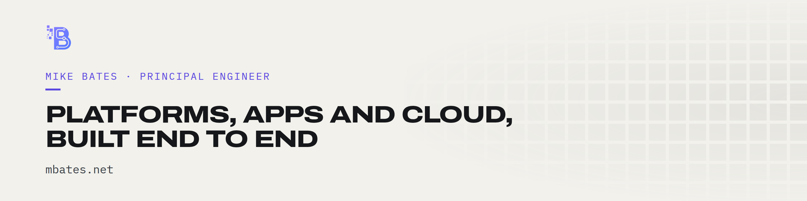
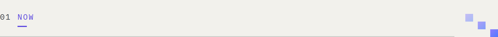
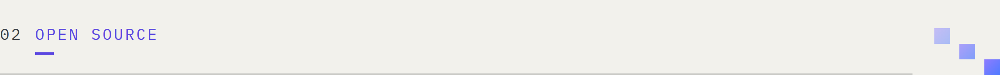
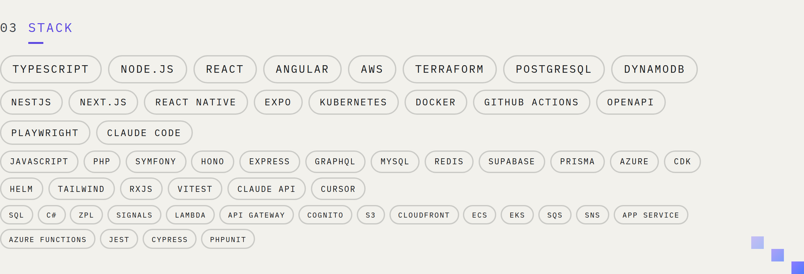
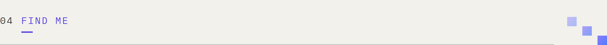

<!-- Images: assets/ is rendered by libs/brand (scripts/build.mjs, social/github-*.html) in
     Bates-Solutions/bates-solutions. Facts come from its libs/content/career/master.md. -->

<a href="https://mbates.net">
  <picture>
    <source media="(prefers-color-scheme: dark)" srcset="assets/banner-mike-dark.png">
    
  </picture>
</a>

Principal engineer in Vancouver, BC, with 25+ years shipping production software. I build
platforms end to end: the API, the front end, the cloud underneath and the pipeline that ships
it. I work through my consultancy, [Bates Solutions](https://github.com/Bates-Solutions).

<picture>
  <source media="(prefers-color-scheme: dark)" srcset="assets/section-now-dark.png">
  
</picture>

- **Ocean Wise.** Lead Backend Engineer on [Whale Report](https://bates-solutions.com/work/ocean-wise),
  real-time whale alerts for mariners and a versioned public partner API. I also set the
  team's standard for AI coding agents: a shared agent repository, Claude Code skills and
  Cursor rules, shipped to every repository as configuration.
- **Well-Plated.** Senior engineer on three clinical React Native apps, and the release
  pipeline that gets them through both stores.
- **getMickled.** My multi-tenant commerce platform on serverless AWS: a storefront per
  business, tenant isolation across 19 Terraform modules.
- **Before:** founding engineer at Casechek, a HIPAA-regulated platform I took from the first
  commit to 200+ US hospitals.

<picture>
  <source media="(prefers-color-scheme: dark)" srcset="assets/section-open-source-dark.png">
  
</picture>

| | |
|---|---|
| [**squareup**](https://github.com/mbates/squareup) | TypeScript SDK for the Square API: 14 services, webhooks for Express, Lambda and Next.js |
| [**stripe**](https://github.com/mbates/stripe) | Typed wrapper for the Stripe API with webhook support |
| [**clover**](https://github.com/mbates/clover) | Clover Ecommerce and Platform APIs, edge-ready, no dependencies |
| [**country-made-in**](https://github.com/mbates/country-made-in) | Chrome extension showing where an Amazon product is made, with the evidence |

The three SDKs share one design and are MIT licensed on [JSR](https://jsr.io/@bates-solutions).

<picture>
  <source media="(prefers-color-scheme: dark)" srcset="assets/section-stack-dark.png">
  
</picture>

<picture>
  <source media="(prefers-color-scheme: dark)" srcset="assets/section-find-me-dark.png">
  
</picture>

[mbates.net ↗](https://mbates.net) ·
[bates-solutions.com ↗](https://bates-solutions.com) ·
[LinkedIn ↗](https://linkedin.com/in/michael-james-bates) ·
[mike@bates-solutions.com](mailto:mike@bates-solutions.com)

Most of my client work lives in private repositories; [mbates.net](https://mbates.net) has the
write-ups.
